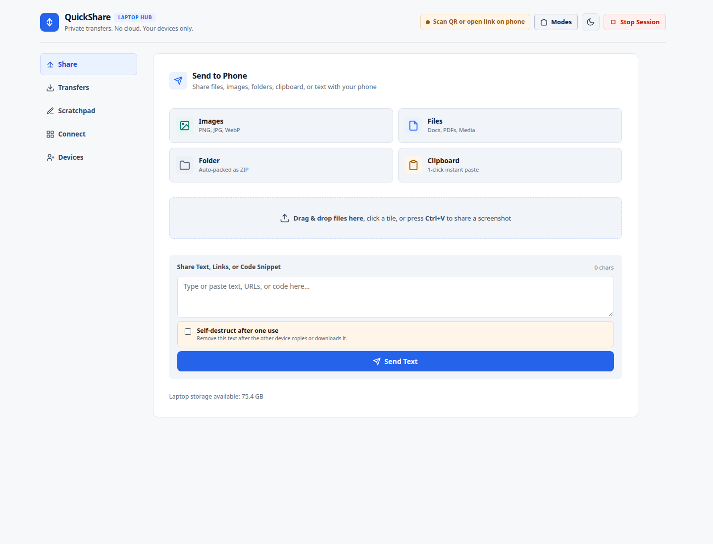
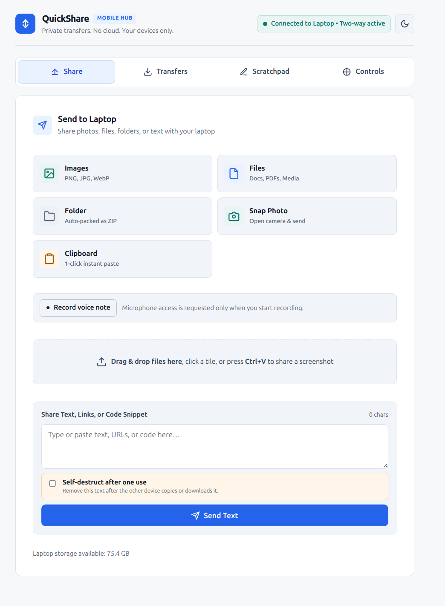

# QuickShare

QuickShare is a private, two-way file and text sharing app for an **Ubuntu or Windows laptop** and an **Android phone** on the same local network. It runs on demand, serves its interface from the laptop, and does not send files through a cloud service.

## Screenshots

### Laptop



### Android phone



## What you can do

- Send files, photos, text, links, and folders between the laptop and phone. Folders are packaged as ZIP files.
- Take a photo with the phone camera or record and send a voice note.
- Browse a shared ZIP archive and download just one file, or download multiple received items together.
- Preview supported documents and code, and play shared audio and video.
- Use the live Scratchpad to keep a note synchronized between devices.
- From the phone, open a shared link on the laptop, request a laptop screenshot, control media and volume, or move presentation slides.
- Approve a phone once or remember it on the laptop for future sessions; remove remembered devices at any time.
- Optionally make shared text disappear after it is copied or downloaded once.
- Optionally protect phone access with a PIN or save received files to an inbox.

## Requirements

- An Ubuntu 22.04+ or Windows 10/11 laptop with Python **3.10 or newer**.
- An Android phone with a current browser such as Chrome.
- Both devices connected to the same Wi-Fi or local network. Guest Wi-Fi and some mesh/router settings isolate devices; see [Troubleshooting](#troubleshooting) if the phone cannot connect.
- Internet access for the initial Python dependency installation. The app itself works locally after setup.

## Install and start

Choose **one** of the laptop setup guides below. QuickShare creates a temporary session when launched; it does not install a background service.

### Windows 10/11

1. Install Python 3.10 or newer from [python.org/downloads/windows](https://www.python.org/downloads/windows/). In the installer, enable **Add python.exe to PATH** and include the **Python Launcher** if offered.
2. Download the project:
   - To use Git, open PowerShell and run:

     ```powershell
     git clone https://github.com/qayam-shaikh/fastshare.git
     cd fastshare
     ```

   - Or use GitHub’s **Code → Download ZIP**, then extract the ZIP.
3. Start QuickShare by double-clicking `quickshare.bat` in the project folder. On its first launch, the script creates a local `.venv` and installs the required packages. Later launches reuse that environment.
4. If Windows prompts about Windows Defender Firewall, allow Python on **Private networks only**. Do not enable access on public networks.
5. Keep the console window open while sharing. It prints the phone URL and a QR code. Scan the code or enter the printed phone URL in Chrome on Android.

You can also launch from PowerShell in the project folder:

```powershell
.\quickshare.bat --pin 1234
```

The batch file passes command-line options through to the app. To install or refresh dependencies yourself:

```powershell
.\.venv\Scripts\python.exe -m pip install -r requirements.txt
```

### Ubuntu 22.04+

1. Install Python and virtual-environment support:

   ```bash
   sudo apt update
   sudo apt install python3 python3-venv
   ```

   `avahi-utils` is optional. When installed, QuickShare uses Avahi to publish `quickshare.local`; otherwise its cross-platform mDNS library handles the alias:

   ```bash
   sudo apt install avahi-utils
   ```

2. Clone the project and enter its folder:

   ```bash
   git clone https://github.com/qayam-shaikh/fastshare.git
   cd fastshare
   ```

3. Create and activate a virtual environment, then install the dependencies:

   ```bash
   python3 -m venv .venv
   source .venv/bin/activate
   python -m pip install --upgrade pip
   python -m pip install -r requirements.txt
   ```

4. Start the app:

   ```bash
   ./quickshare
   ```

   Keep the terminal open while sharing. Scan the displayed QR code or open the printed phone URL on Android. If the launcher is not executable, run `chmod +x quickshare` once, then start it again.

## Connect the phone

1. Start QuickShare on the laptop and leave it running.
2. Connect the phone to the same Wi-Fi network as the laptop.
3. Scan the QR code shown on the laptop, or type the **Phone URL** printed in the terminal into the phone browser. The app also shows the current Wi-Fi IP as a fallback URL.
4. On the laptop, open **Devices** and choose **Allow once** or **Remember** for the new phone. The phone loads the sharing interface after approval.
5. Choose **Remember** to let that phone browser reconnect in later sessions. Remove access later from **Devices → Remembered devices → Forget device**.

QuickShare attempts to publish the stable `quickshare.local` alias on both operating systems. Ubuntu uses Avahi when available and otherwise uses the included cross-platform mDNS library. If alias publishing fails, the app falls back to the laptop’s `.local` hostname. Some routers block mDNS; if neither hostname resolves on the phone, use the IP fallback printed by the app. The phone’s remembered authorization is tied to its browser cookie and the hostname used; clearing site data or changing the hostname can require approval again.

Remembered-device data is stored in the laptop’s user profile: `~/.config/quickshare/trusted_devices.json` on Ubuntu or `%APPDATA%\QuickShare\trusted_devices.json` on Windows. The file stores token hashes, not the phone’s browser token.

## How to use the app

The laptop and phone have a focused page navigation bar:

| Page | How to use it |
| --- | --- |
| **Share** | Choose Images, Files, or Folder; drag and drop files on the laptop; use **Snap Photo** or **Record voice note** on the phone; or send text, links, and code. |
| **Transfers** | Review sent and received items, preview supported files, play media, download items, save received files to the laptop inbox, or use **Download All (ZIP)** when available. Choose **Browse Contents** on a ZIP to inspect it and download individual files. |
| **Scratchpad** | Type on either device. The shared note synchronizes while the session is active. |
| **Connect** (laptop) / **Controls** (phone) | On the laptop, display the QR code and phone links. On the phone, open a link on the laptop, view a laptop screenshot, control media and volume, or send previous/next presentation keys. |
| **Devices** (laptop) | Approve new phones, remember trusted browsers, or forget saved devices. |

### Sharing notes, links, and files

- A link in shared text is clickable on the receiving device. When the phone shares an HTTP(S) link, **Open Tab on Laptop** opens it in the laptop’s default browser.
- Enable **Self-destruct after one use** before sending sensitive text to remove it after the other device successfully copies it or downloads its text file. This is a convenience feature, not encryption or a secure vault.
- On the laptop, press **Ctrl+V** to share a copied screenshot. Clipboard access can depend on the desktop environment; see [platform controls](#laptop-specific-controls).
- Folder shares are ZIP archives. Browse their contents from the transfer card without downloading the whole archive.

### Laptop-specific controls

The main sharing, transfer, scratchpad, device approval, and phone-to-laptop browsing features work on both supported laptop operating systems. Optional desktop controls use platform-specific support:

| Feature | Ubuntu | Windows |
| --- | --- | --- |
| Open a link | Opens in the default browser. | Opens in the default browser. |
| Copy laptop clipboard text | Uses `wl-paste`, `xclip`, or `xsel` when installed. | Reads Unicode text through the native Windows clipboard. |
| Capture laptop screen | Uses `grim`, `gnome-screenshot`, or `scrot`. | Uses Pillow’s Windows screen capture support, installed with the app dependencies. |
| Play/pause, volume, and slides | Uses `playerctl`, `pactl`, and `xdotool`. Install the command you need; QuickShare reports when it is unavailable. | Sends media, volume, and arrow keys to the laptop’s active desktop session. The active application must respond to those keys. |

On Ubuntu, for example, install commonly needed desktop tools with:

```bash
sudo apt install wl-clipboard playerctl pulseaudio-utils xdotool gnome-screenshot
```

You only need the tools for the controls you plan to use. Wayland desktops may need `grim` instead of `gnome-screenshot` or `scrot`. Screenshot capture requires an active, unlocked desktop session.

### Phone camera, microphone, and home-screen install

- **Snap Photo** opens the rear camera when supported by the browser. When the camera returns the captured image, upload begins automatically.
- **Record voice note** requests microphone permission only after you start recording. Browser microphone APIs and installable web apps generally require a trusted HTTPS connection.
- Android browsers may offer **Install App** or **Add to Home screen**. A trusted HTTPS certificate is needed for full PWA, service worker, and microphone support; ordinary sharing works over the default local HTTP session.
- To enable HTTPS, provide a certificate valid for the laptop hostname and trusted by both devices:

  ```bash
  ./quickshare --tls-cert /path/to/quickshare.crt --tls-key /path/to/quickshare.key
  ```

  On Windows, pass certificate paths through the launcher, for example:

  ```powershell
  .\quickshare.bat --tls-cert "C:\certs\quickshare.crt" --tls-key "C:\certs\quickshare.key"
  ```

  An untrusted self-signed certificate will show browser warnings and will not enable secure browser features.

## Useful launch options

Pass options to `./quickshare` on Ubuntu or `quickshare.bat` on Windows:

| Option | Example | Description |
| --- | --- | --- |
| `--pin PIN` | `--pin 1234` | Require a four-digit PIN when a phone joins the session. |
| `--minutes N` | `--minutes 0` | Set the session duration in minutes. The default is 60; `0` runs until stopped. |
| `--port N` | `--port 9000` | Use a particular port. Use `--port 0` to choose an available port. |
| `--save-inbox` | `--save-inbox` | Save a copy of each incoming phone upload to `~/QuickShare-Inbox` (or `--inbox PATH`). |
| `--max-upload-mib N` | `--max-upload-mib 1000` | Set the maximum upload request size in MiB. |
| `--no-browser` | `--no-browser` | Do not automatically open the laptop page. |
| `PATH...` | `./quickshare send ~/Pictures/photo.png` | Add files or folders to the session as it starts. |

Use `./quickshare --help` on Ubuntu or `.\quickshare.bat --help` on Windows for the full list.

## Privacy and network safety

- QuickShare keeps transfer data in a temporary local session and removes it when the session ends. Files are not uploaded to a cloud service.
- The default session expires after 60 minutes. Stop sooner with **Stop Session** on the laptop or `Ctrl+C` in the terminal.
- A new phone needs laptop approval. **Allow once** lasts only for the current session; **Remember** stores a browser-token hash in the laptop user profile. The phone stores its authorization token in an HttpOnly browser cookie.
- Default HTTP traffic is not encrypted. Use QuickShare only on a trusted private network; use HTTPS with a trusted certificate on networks you do not trust.
- The app is designed for a laptop and phone on the same local network, not for exposing the port to the public internet.

## Troubleshooting

**The phone cannot open the link**

1. Confirm both devices are on the same Wi-Fi and that guest/client isolation is disabled.
2. Use the exact **Phone Fallback IP URL** printed in the laptop terminal.
3. On Windows, set the Wi-Fi network profile to **Private** and allow Python through Windows Defender Firewall on private networks (including local network discovery if prompted). On Ubuntu, allow the selected port (default `8765`) on the trusted LAN.
4. Temporarily disconnect a VPN if it routes local-network traffic away from Wi-Fi.

**The `.local` hostname does not work**

Use the printed IP URL instead. QuickShare tries Avahi or its cross-platform mDNS library to publish `quickshare.local`; if that fails, it displays the laptop hostname. Some routers block multicast name discovery even when file sharing over the IP works.

**The phone says it is waiting for approval**

Open **Devices** on the laptop and approve the pending phone. A phone using a different browser profile, cleared cookies, or a different saved hostname may need approval again.

**A phone control is unavailable**

QuickShare reports the missing desktop utility. Install the relevant Ubuntu tool from the [laptop-specific controls](#laptop-specific-controls) table. On Windows, make sure the laptop is awake and that the active player or presentation app responds to standard media or arrow keys.

**The screenshot, camera, microphone, or install prompt is unavailable**

Desktop screen capture needs an active desktop session and supported screenshot backend. Phone camera, microphone, PWA install, and browser clipboard APIs may require a trusted HTTPS origin; the default HTTP mode is intended for basic local sharing.

**Port 8765 is already in use**

Start with `--port 0`; QuickShare will select and print an available port.

## Project layout

```text
fastshare/
├── quickshare                 # Ubuntu launcher
├── quickshare.bat             # Windows launcher; bootstraps a local venv
├── quickshare.py              # Python HTTP server and platform integrations
├── requirements.txt           # Cross-platform Python dependencies
├── .quickshare_vendor/        # Bundled QR-code fallback
├── frontend/
│   ├── index.html             # Laptop and phone app pages
│   ├── styles.css             # Responsive styling
│   └── app.js                 # Sharing, navigation, and remote controls
├── docs/screenshots/          # README UI screenshots
└── tests/                     # Server and platform-helper tests
```

## Tests

From the project directory, run:

```bash
python -m unittest discover -s tests -v
```
